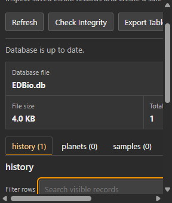
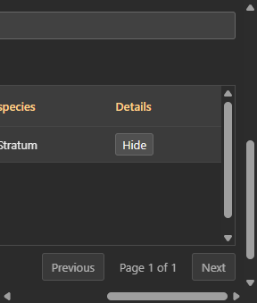

# EDBio

EDBio is a standalone Windows desktop tool for Elite Dangerous: Odyssey
commanders who want to keep their exobiology work organized. It follows the
game's journal as it changes and brings the current commander, system, planet,
biological signals, sample progress, and estimated Vista Genomics value into
one compact application. No account or companion service is required.

Use EDBio to move from a planet scan to completed genetic samples: review
possible species, see what is known about their requirements, track the
Log / Sample / Analyse sequence, and check the distance needed before taking
the next sample. Predictions are identified as predictions, not confirmed
discoveries, and credit values and first-footfall bonuses are estimates rather
than guaranteed payouts.

EDBio keeps discovery history in a local SQLite database, with search, CSV
export, database inspection, and backups. Optional sound alerts can notify you
when an FSS scan finds biological signals, and an optional overlay can show
bio-signal information while Elite Dangerous is the foreground application.
The nearby Vista Genomics search uses public Spansh station data to help find a
turn-in location; station listings may be out of date.

## Screenshots

These screenshots show the database panel: saved-record browsing, table
filtering, and expanded record details.



*Browse saved records, review database status, and access CSV export and backup tools.*



*Expand a history row to inspect the saved record fields.*

## Features

- Reads Elite Dangerous journal files in real time (incremental, handles rotation)
- Detects the current commander, system, and planet from the journal
- Lists biological signals and predicted species for the active planet
- Tracks genetic sample progress using ScanOrganic events (Log / Sample / Analyse)
- Calculates surface distance from the reference sample using great-circle math
- Shows estimated Vista Genomics payouts per species and per planet
- First footfall multiplier shown as an estimate, never guaranteed
- History tab with search, filtering, and CSV export (stored in SQLite)
- Database tab for inspecting saved records and creating SQLite backups
- Rust-backed incremental journal file reading
- Always-on-top, minimize to system tray, remembers window size and position
- Optional sound alert when an FSS scan finds biological signals, with grouped
  previewable sound choices and custom MP3, WAV, or OGG imports
- Optional in-game bio overlay showing the planet, signal count, and identified
  genera when available
- Journal-based docked-station detection and one-click nearby Vista Genomics
  station search using Spansh station data
- Manual journal directory selection
- Settings dialog and About dialog

## Download

Pre-built Windows installers are available on the GitHub Releases page for this
repository. Run `EDBio-Setup-1.0.0.exe` to install EDBio for the current Windows user.
The desktop shortcut option is checked by default in the installer.

## How To Use

1. Download and run `EDBio-Setup-1.0.0.exe`. Python does not need to be installed.
2. On first launch, choose a bio-alert sound and use Preview to test it.
3. Start Elite Dangerous and load into a game.
4. EDBio detects the journal directory automatically
   (%USERPROFILE%\Saved Games\Frontier Developments\Elite Dangerous\).
   If it doesn't, use File > Journal Directory to pick it manually.
5. Fly to a planet, scan it, and use the Surface Area Scanner. Biological
   signals, predicted species, and sample tracking appear in the Exobiology tab.
6. Land and collect genetic samples. Sample progress, distance required, and
   distance remaining update as you move.
7. Use the History tab to review past discoveries and export to CSV.

Enable the sound alert and the optional overlay in Tools > Settings or View.
The overlay only appears while Elite Dangerous is the foreground application;
set the game display mode to Borderless or Windowed for it to appear.
Add personal alert sounds from Tools > Settings. The Exobiology tab shows your
docked station and can search Spansh for the nearest listed Vista Genomics
service using the selected radius (25–1000 ly). Selling prices do not depend on
which Vista Genomics station you use; the search recommends a nearby turn-in
location, not a higher payout. Station listings are community data and may be
out of date; an internet connection is required to search.

The application opens normally even when Elite Dangerous is closed, showing
saved data from previous sessions.

## Requirements

- Windows 10 or Windows 11
- Elite Dangerous with Odyssey (for journal-based tracking)
- No Python installation required for the pre-built executable

## Building From Source

```bash
# Clone the repository
git clone <repository-url>
cd EDBio

# Create a virtual environment (optional but recommended)
python -m venv .venv
.venv\Scripts\activate

# Install Python dependencies
pip install -r requirements.txt

# Build the Rust reader and TypeScript database panel for source runs
python build_exe.py --components-only

# Run from source
python main.py

# Build the standalone Windows executable (also builds Rust and TypeScript)
python build_exe.py

# Build the per-user Windows installer (requires Inno Setup 6)
ISCC.exe installer\EDBio.iss
```

The source build requires Python 3.12+, PySide6-WebEngine, Node.js/npm,
Rust/Cargo, and the Microsoft C++ Build Tools workload. `--components-only`
configures the local Rust extension and compiles the web panel before running
from source. The executable and installer are written to `dist\`.
Station searches use the public Spansh stations API
(`https://spansh.co.uk/api/stations/search`); no API key or commander account
is required.

## Known Issues

- Species prediction relies on community-documented environmental requirements.
  Some species have incomplete requirement data and are shown with whatever is
  known; missing requirements do not prevent a prediction but reduce confidence.
- First footfall bonuses are estimates. The game determines actual first
  footfall eligibility, which EDBio cannot verify from the journal.
- Genetic distance tracking requires the player to be on the planet surface
  with latitude and longitude available (Touchdown event). Without coordinates,
  distance is shown as Unknown.

## Credits

Created by **Mu_bloxi (CMDR MUBLOXI)**.
Project: [Mubloxi/EDBio](https://github.com/Mubloxi/EDBio)

- PySide6 (Qt for Python) - LGPL
- Pillow - HPND
- PyInstaller - GPL (build tool only, not distributed with the app)
- PyO3 - Apache-2.0 / MIT
- TypeScript - Apache-2.0
- pytest - MIT

Biological reference data and Vista Genomics prices are compiled from public
Elite Dangerous community documentation (ED-DSN, Canonn, Elite Dangerous Wiki).
Species names, planetary data, and Elite Dangerous content are the property of
Frontier Developments plc.

This project does not incorporate code from EDMC BioScan (GPL) or EDEXO
(PolyForm Noncommercial / CC BY-NC-SA), both of which carry incompatible
licenses for this project.

## Disclaimer

EDBio is not affiliated with Frontier Developments, the developers of Elite
Dangerous. Elite Dangerous is a trademark of Frontier Developments plc.
