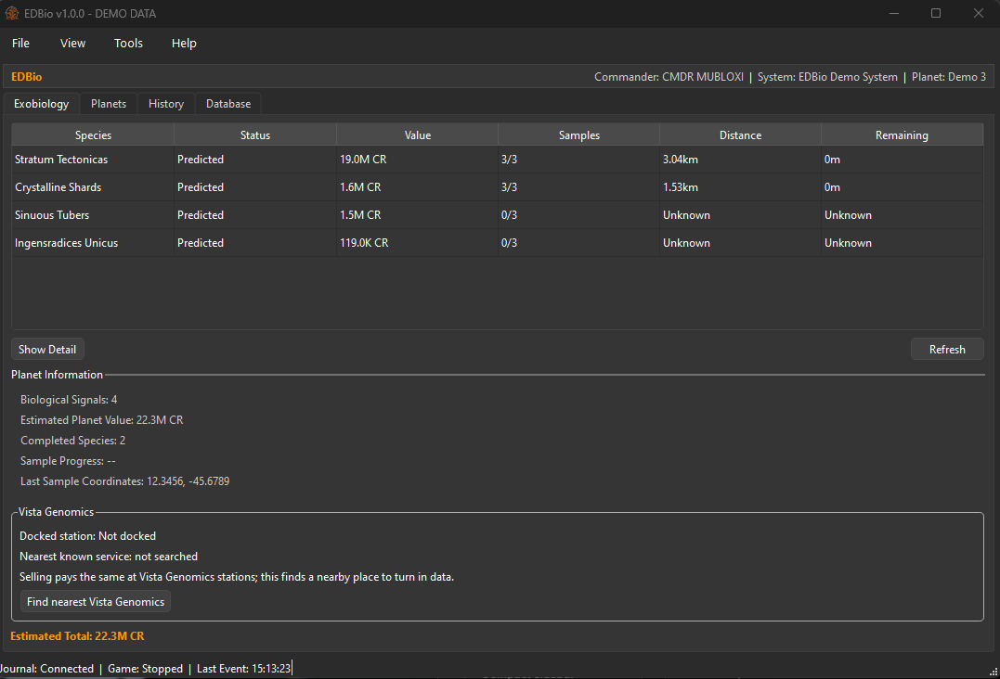
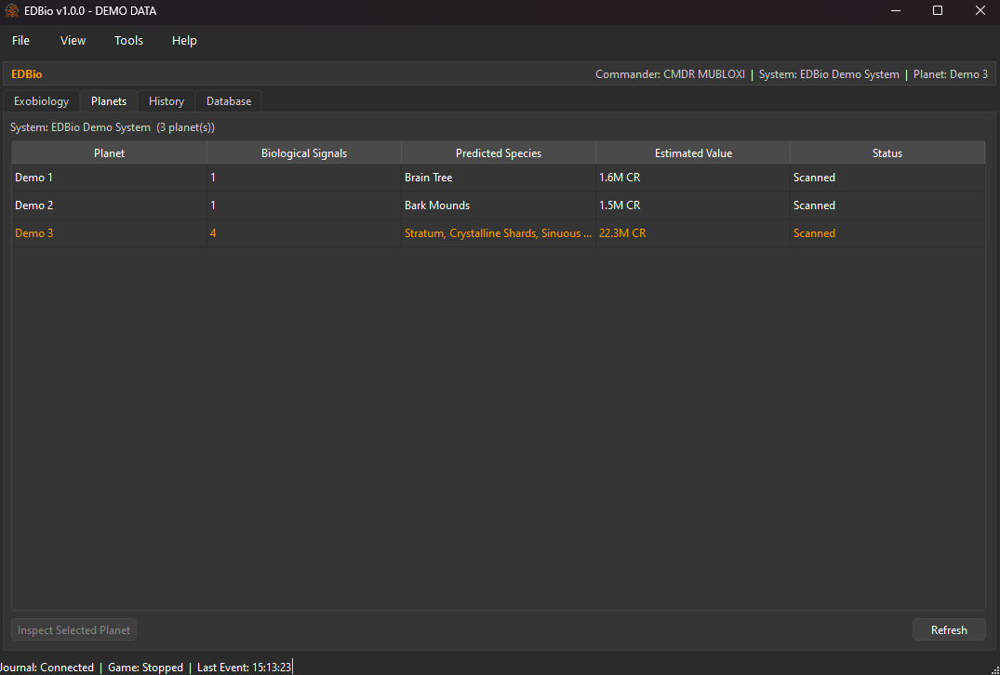
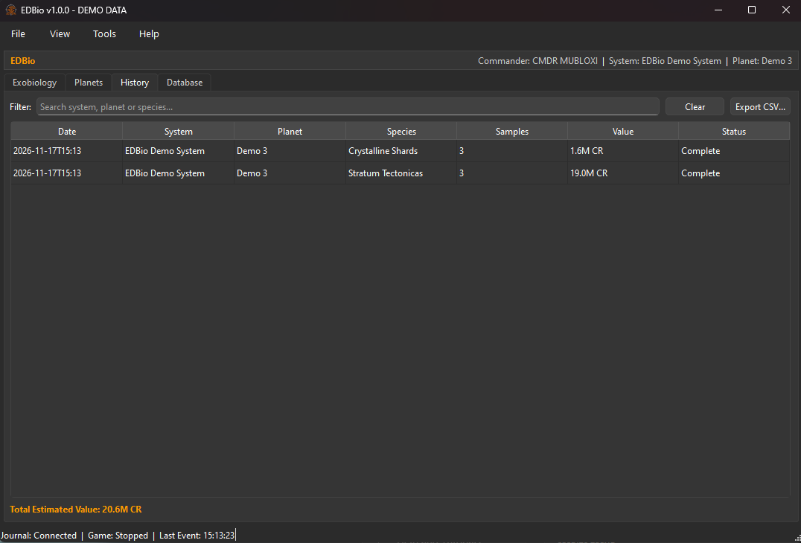
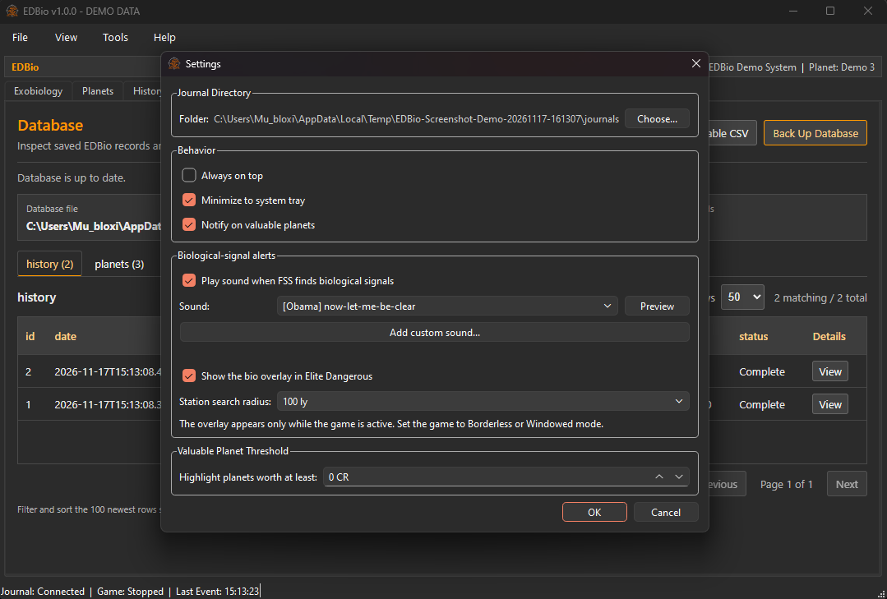
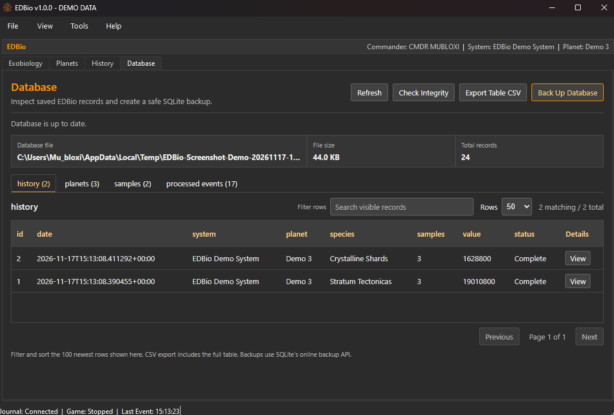
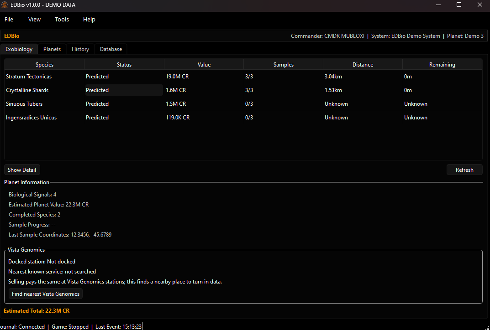
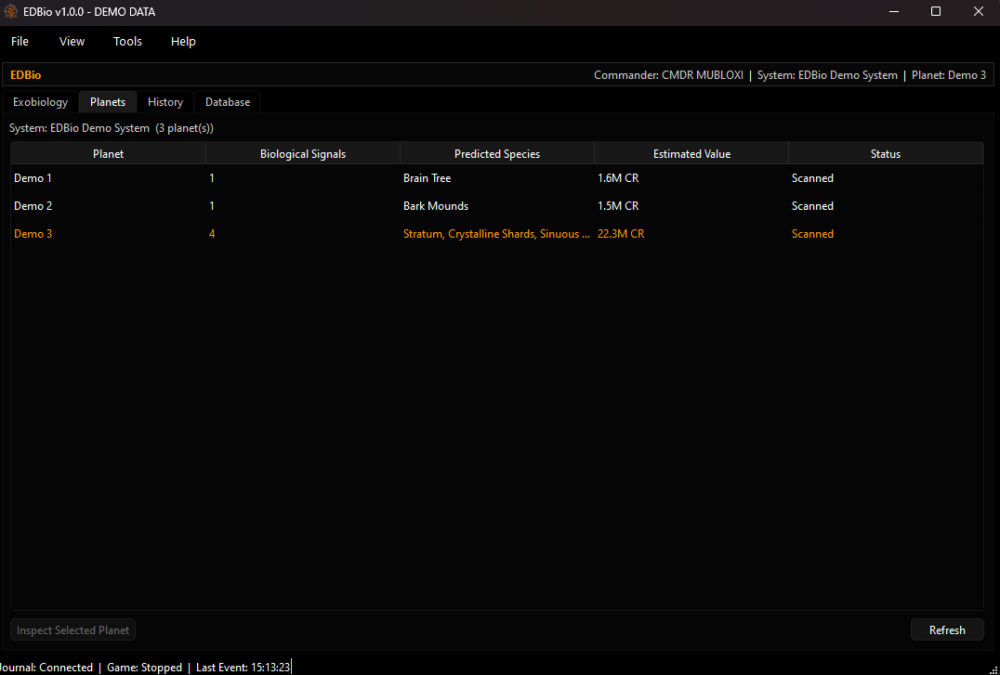
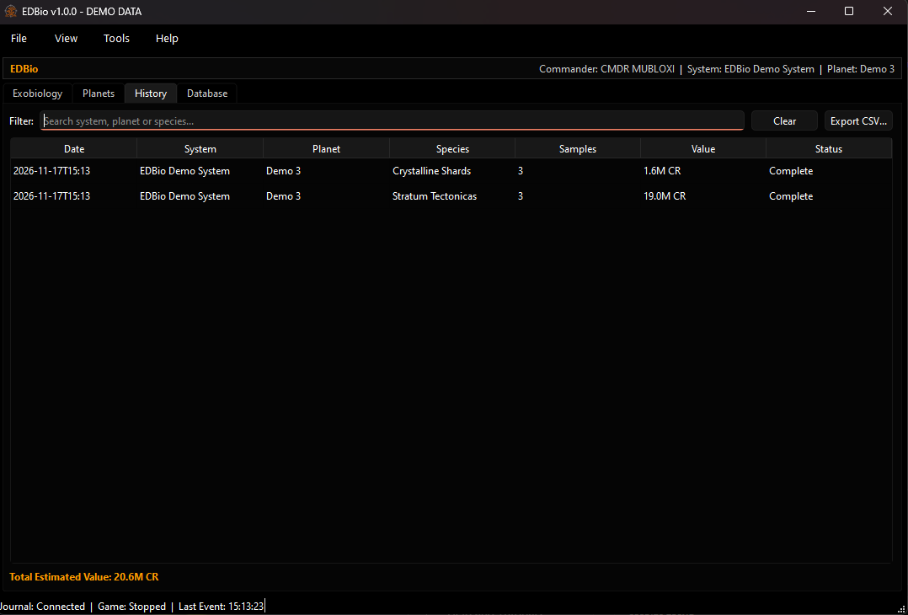
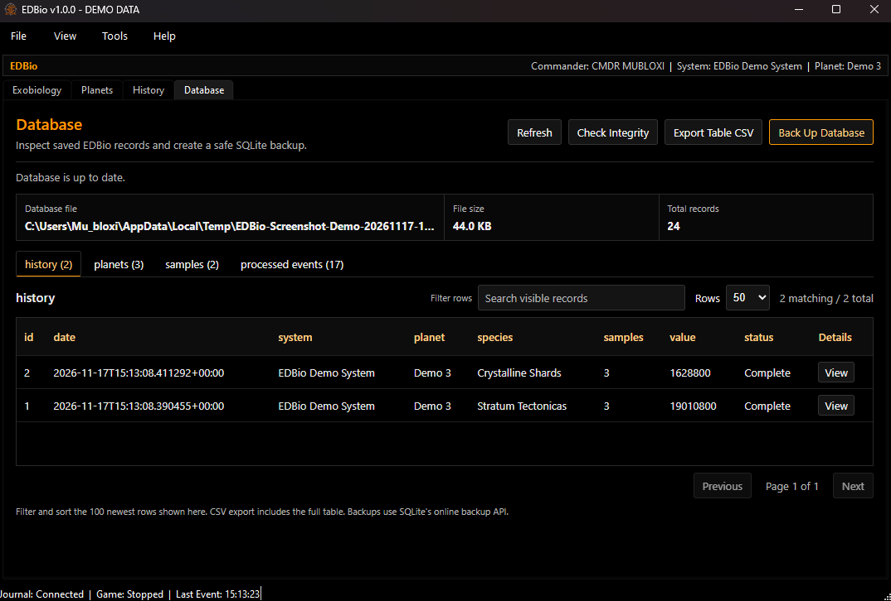

# EDBio

EDBio is a Windows app for Elite Dangerous: Odyssey. It reads your game journal
and helps you track bio signals, possible species, samples, credits, and past
finds. It works on your PC. You do not need an account.

Species are shown as predictions, not confirmed finds. Credit amounts and
first footfall bonuses are estimates. The game decides the real payout.

Your history stays in a local SQLite database. You can search it, export it to
CSV, view saved data, and make backups. You can also turn on sound alerts and
an in-game bio overlay. The Spansh search can help find a nearby Vista Genomics
station. Its station list may be out of date.

## Screenshots

These are screenshots of the Windows app. The commander, system, planets, and
bio data are fake demo data. They are not from a live game session.

### Normal theme







### OLED theme






## Features

- Reads your game journal and keeps up with new log files
- Shows your commander, system, and planet
- Shows bio signals and possible species for the current planet
- Tracks the Log / Sample / Analyse steps and the distance needed for the next sample
- Shows estimated Vista Genomics credits for species and planets
- Shows first footfall as an estimate
- Saves your finds in a history you can search and export to CSV
- Lets you check saved data and back up the database
- Uses a Rust reader to load journal files
- Can stay on top, go to the system tray, and remember its window size
- Can play a sound when an FSS scan finds bio signals
- Includes built-in sounds and lets you add MP3, WAV, and OGG files
- Can show the planet, signal count, and known genera in an in-game overlay
- Finds your docked station from the journal and can search Spansh for a nearby
  Vista Genomics station
- Finds your journal folder and reads old logs into the database
- Lets you choose the journal folder yourself if needed
- Includes Settings and About screens

## Download

Get the [EDBio 1.0.0 Windows installer](https://github.com/Mubloxi/EDBio/releases/download/v1.0.0/EDBio-Setup-1.0.0.exe)
or see the [GitHub Releases page](https://github.com/Mubloxi/EDBio/releases).
Run `EDBio-Setup-1.0.0.exe` to install the app for your Windows user. The
installer offers a desktop shortcut, checked by default.

## How To Use

1. Download and run `EDBio-Setup-1.0.0.exe`. You do not need to install Python.
2. The first time you open EDBio, pick a sound and use Preview to hear it.
3. Start Elite Dangerous and load into the game.
4. EDBio finds your journal folder and reads its old logs. If it cannot find the
   folder, use File > Journal Directory to choose it.
5. Scan a planet and use the Surface Area Scanner. Open the Exobiology tab to
   see bio signals, possible species, and sample progress.
6. Land and take samples. EDBio updates the sample count and distance as you move.
7. Open History to check your past finds or export them to CSV.

Turn on sound alerts and the overlay in Tools > Settings or View. EDBio starts
with the normal dark gray theme. Choose View > OLED theme for a mostly black
screen. This also changes the Database tab.

The overlay only shows while Elite Dangerous is the active window. Set the
game to Borderless or Windowed mode to use it.

You can add your own sounds in Tools > Settings. The Exobiology tab shows your
docked station and can search Spansh for a nearby Vista Genomics station.
Choose a search range from 25 to 1000 ly. The station does not change your
payout. Spansh data may be out of date, and station search needs an internet
connection.

EDBio can also open when the game is closed. It will show data saved from
earlier sessions.

## Requirements

- Windows 10 or Windows 11
- Elite Dangerous with Odyssey, if you want journal tracking
- No Python needed for the installer

## Building From Source

```bash
# Clone the repository
git clone <repository-url>
cd EDBio

# Create a virtual environment (optional but recommended)
python -m venv .venv
.venv\Scripts\activate

# Install Python dependencies
pip install -r requirements.txt

# Build the Rust reader and TypeScript database panel for source runs
python build_exe.py --components-only

# Run from source
python main.py

# Build the standalone Windows executable (also builds Rust and TypeScript)
python build_exe.py

# Build the per-user Windows installer (requires Inno Setup 6)
ISCC.exe installer\EDBio.iss
```

To build from source, you need Python 3.12 or newer, PySide6-WebEngine,
Node.js/npm, Rust/Cargo, and Microsoft C++ Build Tools.
`--components-only` builds the Rust reader and database panel so you can run
from source. The app and installer are saved in `dist\`.

Station search uses Spansh public data
(`https://spansh.co.uk/api/stations/search`). You do not need an API key or
commander account.

## Known Issues

- Some species data is incomplete. EDBio shows what is known, but may list
  extra possible species when details are missing.
- The game decides who gets first footfall. EDBio cannot check this from the
  journal, so the bonus is only an estimate.
- Distance tracking needs your location on the planet. If the journal has no
  latitude or longitude, EDBio shows the distance as Unknown.

## Credits

Created by **Mu_bloxi (CMDR MUBLOXI)**.
Project: [Mubloxi/EDBio](https://github.com/Mubloxi/EDBio)

- PySide6 (Qt for Python) - LGPL
- Pillow - HPND
- PyInstaller - GPL (build tool only, not distributed with the app)
- PyO3 - Apache-2.0 / MIT
- TypeScript - Apache-2.0
- pytest - MIT

Bio data and Vista Genomics prices come from public Elite Dangerous community
sources, including ED-DSN, Canonn, and the Elite Dangerous Wiki. Elite
Dangerous and its names belong to Frontier Developments plc.

EDBio does not use code from EDMC BioScan or EDEXO because their licenses do
not fit this project.

## Disclaimer

EDBio is not made by or connected to Frontier Developments. Elite Dangerous is
a trademark of Frontier Developments plc.
